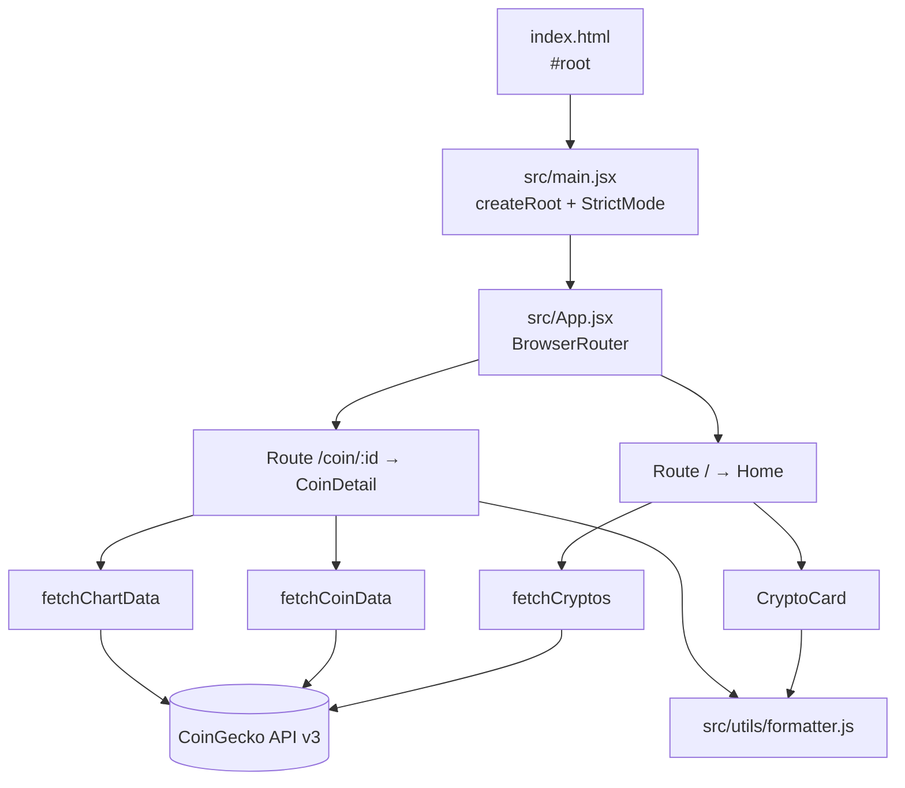

# Architecture

This document explains how the application is structured, how a request flows from the browser to CoinGecko and back, and where state lives.

## Overview

Crypto Tracker is a client-only single-page application. There is no backend, database, authentication, or server-side rendering. The browser fetches JSON directly from the CoinGecko public API and renders it with React.

## Folder responsibilities

| Path | Responsibility |
| --- | --- |
| `index.html` | HTML shell. Mounts the app at `#root` and loads `src/main.jsx` as a module. |
| `src/main.jsx` | Creates the React root, wraps the app in `StrictMode`, imports global CSS. |
| `src/App.jsx` | Declares `BrowserRouter` and the route table. No layout or data logic. |
| `src/pages/Home.jsx` | Owns list state: fetching, polling, search, sort, grid/list toggle. |
| `src/pages/CoinDetail.jsx` | Owns detail state: coin fetch, chart fetch, loading/empty states, chart rendering. |
| `src/components/CryptoCard.jsx` | Pure presentational card for one coin. Links to the detail route. |
| `src/api/coinGecko.js` | All HTTP access to CoinGecko. Three exported async functions. |
| `src/utils/formatter.js` | Pure formatting helpers for price and market-cap values. |
| `src/index.css` | Global styles, design tokens, layout, components, responsive rules. |
| `src/App.css` | **Unused** leftover from the Vite template; not imported anywhere. |
| `public/` | Static assets copied verbatim to the build output (`arrow-up.png`, `arrow-down.png`, `vite.svg`). |

## Routing

Routing uses the `react-router` v7 package (not `react-router-dom`).

| Path | Element | Params |
| --- | --- | --- |
| `/` | `<Home />` | — |
| `/coin/:id` | `<CoinDetail />` | `id` — CoinGecko coin id such as `bitcoin` or `ethereum`. |

`CryptoCard` builds links with `` `/coin/${crypto.id}` ``, and `CoinDetail` reads the param with `useParams()`.

There is no catch-all (`*`) route and no 404 page. An unmatched URL renders an empty router outlet.

## Data flow

### Home (`/`)

1. `Home` mounts with `isLoading = true`.
2. An effect registers `setInterval(fetchCryptoData, 30000)` and clears it on unmount.
3. **The first call happens only when the interval fires**, about 30 seconds later.
4. `fetchCryptoData` calls `fetchCryptos()`, stores the array in `cryptoList`, and sets `isLoading = false`.
5. A second effect runs `filterAndSort()` whenever `sortBy`, `cryptoList`, or `searchQuery` changes.
6. `filterAndSort` filters by name/symbol substring and sorts a copy in place, then stores the result in `filteredList`.
7. The render maps `filteredList` to `<CryptoCard>` inside a container whose class (`grid` or `list`) comes from `viewMode`.

Search and sort are entirely client-side over the fetched page of 100 coins.

### Coin detail (`/coin/:id`)

1. `CoinDetail` reads `id` from the route and mounts with `isLoading = true`.
2. An effect keyed on `id` starts **two independent requests in parallel**:
   - `loadCoinData` → `fetchCoinData(id)` → `coin` state.
   - `loadChartData` → `fetchChartData(id)` → transform → `chartData` state.
3. Both functions share the single `isLoading` flag and each sets it to `false` in its own `finally` block.
4. Render order:
   - `isLoading === true` → spinner.
   - `isLoading === false && coin === null` → "coin not found" with a back button.
   - Otherwise → detail UI with price block, chart, and stat cards.

Chart transformation: `data.prices` (array of `[timestampMs, price]`) is mapped to `{ time, price }` where `time` is a short `"Mon D"` label and `price` is a **string** rounded to two decimals.

## State management

There is no global store, context provider, or cache. State is local to each page via `useState`.

| Component | State | Purpose |
| --- | --- | --- |
| `Home` | `cryptoList` | Raw API response. |
| `Home` | `filteredList` | Derived, display-ready list. |
| `Home` | `isLoading` | Spinner visibility. |
| `Home` | `viewMode` | `"grid"` or `"list"`. |
| `Home` | `sortBy` | Sort key. |
| `Home` | `searchQuery` | Search text. |
| `CoinDetail` | `coin` | `/coins/{id}` response. |
| `CoinDetail` | `chartData` | Transformed chart points. |
| `CoinDetail` | `isLoading` | Spinner visibility. |

Derived data (`filteredList`, `chartData`) is stored in state rather than computed during render.

## Error handling

- API functions throw on non-2xx responses with a fixed message; `fetch` itself rejects on network failure.
- Pages catch errors, log them with `console.error`, and leave prior state untouched.
- There is **no user-facing error message**, retry button, toast, or error boundary.
- Because the detail page's shared `isLoading` becomes `false` on either request finishing, a failed coin request renders the "coin not found" state.

## Styling architecture

- One global stylesheet (`src/index.css`) imported once in `src/main.jsx`.
- Plain class names, no CSS modules, no CSS-in-JS, no preprocessor.
- Dark glassmorphism theme with CSS custom-property-free hard-coded colors (see [Styling](styling.md)).
- One responsive breakpoint at `768px`.
- `App.css` is dead code from the template and is not imported.

## Extensibility points

| Goal | Touch |
| --- | --- |
| Add a route | `src/App.jsx` |
| Add a page | New file under `src/pages/`, then register in `src/App.jsx` |
| Add an API call | `src/api/coinGecko.js` |
| Add a reusable UI piece | `src/components/` |
| Add a formatter | `src/utils/formatter.js` |
| Change theme/layout | `src/index.css` |
| Change polling or page size | `src/pages/Home.jsx`, `src/api/coinGecko.js` |

## Related documents

- [API reference](api.md)
- [Pages](pages.md)
- [Components](components.md)
- [Styling](styling.md)
- [Known issues](known-issues.md)
